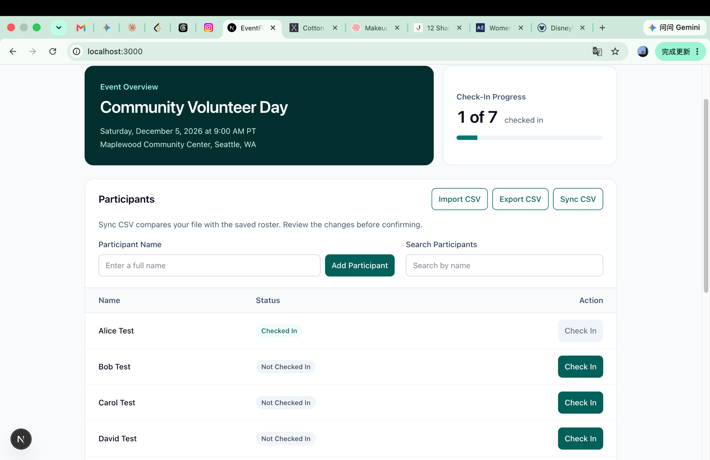
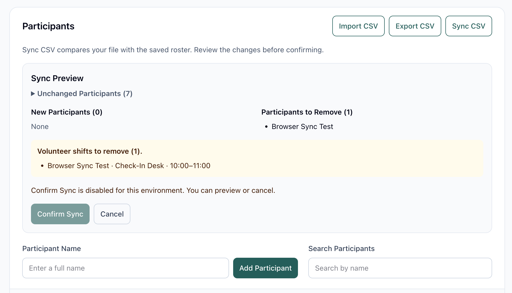
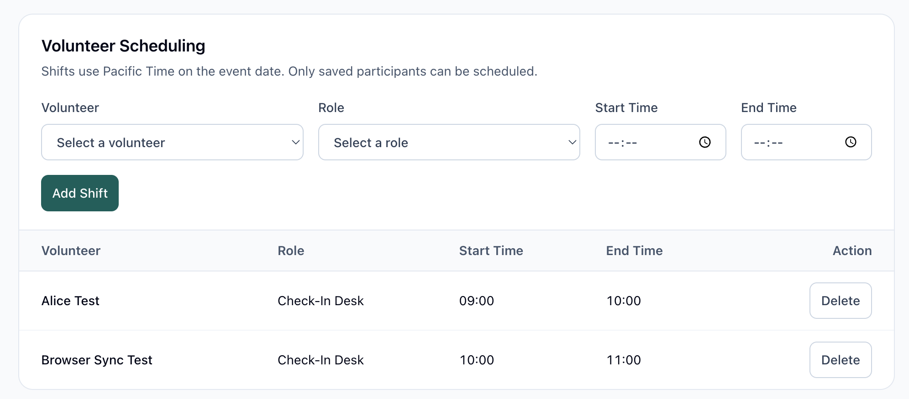

# EventFlow

**Event Check-in & Volunteer Management Web Application**

EventFlow helps event organizers manage a roster, track attendance, and schedule volunteers. The repository is set up for local development and includes a reviewed database sync implementation for an approved test environment.

## Features

- **Authentication** — Sign up with email and password, confirm your email, log in, and log out. The dashboard requires a verified session.
- **Events and Participants** — Create a sample event for an empty account, view event details, and add or search participants.
- **Check-In** — Check participants in from the roster and see attendance totals update.
- **CSV Import and Export** — Import participants into the current event and download the saved roster. Import skips duplicate names and preserves existing check-in states.
- **CSV Sync Preview** — Compare a CSV with the saved roster and review additions, removals, and any affected volunteer shifts before confirming or canceling.
- **CSV Confirm Sync** — Apply an explicitly confirmed preview in a database transaction. Participants retained by the sync keep their IDs, check-in states, and shifts.
- **Volunteer Scheduling** — Assign and delete shifts. Overlapping shifts for the same volunteer are rejected.

## Screenshots

### Dashboard Overview

View event details, the participant roster, and real-time check-in progress.



### CSV Sync Preview

Compare a CSV with the saved roster and review participants and volunteer shifts marked for removal. This test-environment screenshot shows Confirm Sync disabled by the environment setting.



### Volunteer Scheduling

Choose a volunteer and role, set shift times, and review existing assignments.



## Tech Stack and Data

EventFlow uses Next.js, React, TypeScript, and Tailwind CSS. Supabase Auth manages sessions, and Supabase PostgreSQL persists events, participants, check-ins, and shifts. Row-level security (RLS) scopes database access to the signed-in organizer. Saved changes are loaded again on refresh.

## Local Development

Use Node.js 20.9 or newer and npm.

```bash
git clone https://github.com/jzhan-591/eventflow.git
cd eventflow
npm ci
```

Configure an independent Supabase development project with the EventFlow tables, ownership policies, and Email Auth. In your local `.env.local`, set `NEXT_PUBLIC_SUPABASE_URL` and `NEXT_PUBLIC_SUPABASE_PUBLISHABLE_KEY` for that project. For email confirmation, configure the Supabase site URL for your local origin and point the Confirm signup email link to `{{ .SiteURL }}/auth/confirm?token_hash={{ .TokenHash }}&amp;type=email`.

```bash
npm run dev
```

Open [http://localhost:3000](http://localhost:3000), create an account, and log in. If your account has no events, use **Create Sample Event** to start with Community Volunteer Day.

## CSV Format

CSV files use the `Name` and `Status` columns. Supported statuses are `Checked In` and `Not Checked In`. When an export contains names that could be interpreted as spreadsheet formulas or that need protection for an exact round trip, EventFlow writes those names as inert encoded text and adds a format marker. Other names and all check-in statuses remain readable. Import and Sync Preview restore the original names from the marked file. Keep the original exported file for a lossless re-import.

## Confirm Sync Availability

Confirm Sync is off by default. It can be enabled only after approval in the designated EventFlow-Test project. The server requires `EVENTFLOW_ENABLE_CONFIRM_SYNC=true`, an exact match for that project's Supabase URL, a valid preview receipt, and the installed signed sync RPC. Keep the signing key in server-only configuration. See the [sync deployment review](supabase/review/DEPLOYMENT.md) for the setup and test sequence.

## Local Checks

```bash
npm run lint
npx tsc --noEmit
node --test tests/participant-csv.test.mjs
npm run build
```
